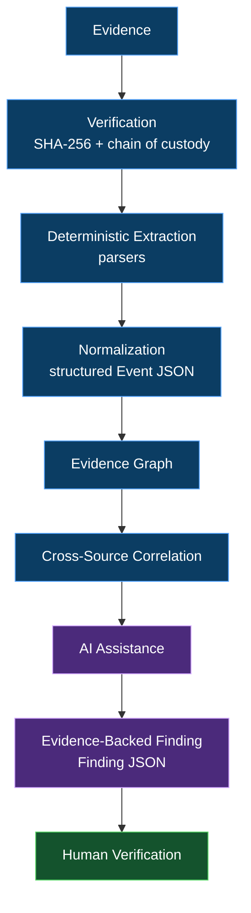
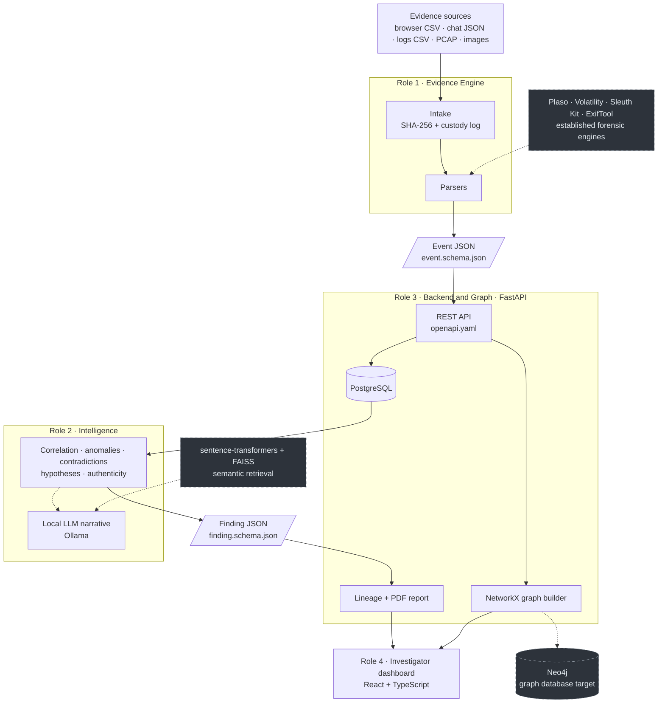
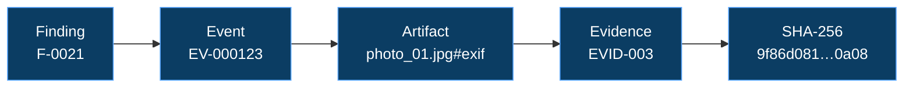
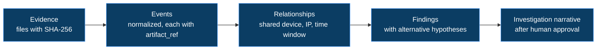

<div align="center">

# PRAMANA

### From Digital Traces to Defensible Investigation.

**Forensics first. AI second.**

PRAMANA is a local-first, AI-assisted platform for cyber investigation and digital forensics.
It hash-verifies evidence at intake, normalizes it into structured events, correlates it across sources,
and produces findings that link back to the exact artifact they came from, so every conclusion can be defended.


[Problem](#the-problem) · [Approach](#the-pramana-approach) · [Features](#core-features) · [Architecture](#architecture) · [Traceability](#evidence-to-finding-traceability) · [Contracts](#data-and-api-contracts) · [Getting Started](#getting-started)

</div>

<br/>

Built for SUTRAM 2026.

---

## The Problem

Digital evidence is scattered across devices, logs, applications, metadata, communications and timelines. Established forensic tools extract that evidence extremely well. The hard part comes afterwards: connecting artifacts across sources, reconstructing what happened and when, spotting contradictions, and turning all of it into a narrative an investigator can defend.

PRAMANA is designed around that gap.

---

## The PRAMANA Approach



<sub>Blue: deterministic steps · Purple: AI-assisted steps · Green: the investigator decides.</sub>

**The core idea:**

> Unlike AI tools that generate investigative conclusions, PRAMANA generates evidence-backed conclusions where every AI finding is traceable to verified digital artifacts and cross-source relationships.

---

## Why PRAMANA?

PRAMANA does not try to replace forensic engines. It is an investigation-intelligence layer designed to sit around them. The table compares workflow styles in general terms; the PRAMANA column describes what its contracts and design call for.

| | Traditional forensic workflow | Generic AI investigation assistant | PRAMANA |
| :--- | :--- | :--- | :--- |
| **Evidence provenance** | Strong inside each tool; often carried by hand between tools | Depends on what is pasted into the prompt | Every event carries `evidence_id`, `artifact_ref` and the source file's `sha256` |
| **Deterministic extraction** | A core strength | Often not the focus | Parsers emit schema-validated events; no model in the extraction path |
| **Cross-source correlation** | Largely analyst-driven | Possible, but links may not be inspectable | Explicit rules: shared actor, device, IP or file hash within a time window |
| **Explainability** | Analyst notes and reports | Varies by tool | Findings carry `reasoning` and the `evidence_event_ids` behind them |
| **AI traceability** | Not applicable | Varies; claims may not map to artifacts | A finding must cite at least one event (`minItems: 1` in the schema) |
| **Human verification** | Analyst review | Often left to the user | `needs_human_review` flag plus `pending` / `approved` / `rejected` status |
| **Investigation timeline** | Available in dedicated timeline tools | Usually narrative text | Events API filterable by time range and source |
| **Evidence lineage** | Largely manual | Rarely available | Finding → events → evidence → SHA-256 lineage |

---

## Core Features

| | Capability | What it does | Where it lives |
| :-: | :--- | :--- | :--- |
| 🔐 | **Evidence hashing and IDs** | Streaming SHA-256, `EVID-###` evidence IDs, intake record | `evidence-engine/intake/hashing.py` |
| 🔐 | **Chain of custody** | Append-only, hash-chained custody log with a tamper check | `evidence-engine/intake/custody.py` |
| 🗄 | **Evidence Vault** | Upload, hash and list evidence together with its custody entries | `backend/app/routers/evidence.py`, `frontend/src/pages/EvidenceVault.tsx` |
| 🧩 | **Evidence normalization** | One normalized event shape for browser, chat, log, PCAP and image sources | `contracts/event.schema.json`, `evidence-engine/parsers/` |
| 🕸 | **Evidence graph** | Person, device, file, IP and location nodes linked by event actions | `backend/app/graph/builder.py` |
| 🔎 | **Cross-source correlation** | Groups events sharing an actor, device, IP or hash within a time window (120 s by default) | `intelligence/correlate.py` |
| ⏱ | **Timeline reconstruction** | Time-ordered events, filterable by range and source | `GET /cases/{id}/events`, `frontend/src/pages/Timeline.tsx` |
| ⚠️ | **Anomaly detection** | Rule-based: odd-hour login, unusual extension, file-access burst | `intelligence/anomalies.py` |
| ⚠️ | **Contradiction detection** | Image location vs GPS vs IP, modified-before-created, same name with two hashes | `intelligence/contradictions.py` |
| 🧠 | **Alternative hypotheses** | 2–3 competing explanations with the evidence needed to tell them apart | `intelligence/hypotheses.py` |
| 🖼 | **Authenticity assessment** | Multi-signal low / medium / high rating for images, never a verdict of "fake" | `intelligence/authenticity.py` |
| 🤖 | **Explainable AI narrative** | A local LLM (Ollama) writes a timeline that may cite only the events it is given | `intelligence/narrative.py` |
| 🔗 | **Evidence lineage** | Walk a finding to its events, evidence, SHA-256 and source file | `backend/app/reports/lineage.py` |
| 👤 | **Human verification** | The investigator approves or rejects each finding | `contracts/finding.schema.json`, `PATCH /findings/{id}` |
| 📄 | **Investigation reporting** | Reviewed PDF with evidence table, custody log and approved findings | `backend/app/reports/export_pdf.py` |
| 🇮🇳 | **India-aware reporting** | Evidence table laid out along BSA Section 63 certificate fields, and clearly stated not to be a legal certificate | `backend/app/reports/export_pdf.py` |

---

## Architecture



<sub>Solid lines are the core pipeline. Dashed grey boxes are the established tools and stores PRAMANA is designed to work alongside.</sub>

**Forensics first, AI second.** Hashing, extraction, correlation and anomaly rules are deterministic code that anyone can re-run and inspect. Findings are structured claims tied to specific event IDs. The local LLM only drafts narrative from events it is handed, and any sentence that cites nothing, or cites events outside its input, is rejected.

---

## Evidence to Finding Traceability

A finding is only useful if an investigator can walk it back to the original bytes. The lineage chain below uses the illustrative values from `contracts/openapi.yaml`:



| Step | What is recorded |
| :--- | :--- |
| **Raw evidence** | The original file as uploaded |
| **Hash / verify** | SHA-256, evidence ID, size and intake time, plus a hash-chained custody entry |
| **Extract artifact** | The exact row, packet or tag the data came from (`artifact_ref`) |
| **Normalize event** | A schema-valid Event that carries the source file's `sha256` |
| **Connect evidence** | Entities and relationships across events in the evidence graph |
| **Correlate** | Events grouped by shared actor, device, IP or hash within a time window |
| **Generate finding** | A claim with `confidence`, `reasoning` and `alternatives` |
| **Attach evidence references** | `evidence_event_ids`, with at least one required by the schema |
| **Human verification** | `needs_human_review`, then `approved` or `rejected` by the investigator |

AI assists the investigation; it is never an untraceable source of truth. If a claim cannot be walked back to a verified artifact, it is not presented as a finding.

---

## Investigation Workflow


<sub>Steps: ingest evidence · verify integrity · extract artifacts · normalize artifacts · build evidence graph · correlate events · detect anomalies and contradictions · generate evidence-backed findings · review alternative hypotheses · human verification · export investigation report.</sub>

---

## Repository Structure

```text
pramana-dfir/
├── .github/
│   ├── CODEOWNERS                  # per-role ownership
│   └── pull_request_template.md
├── contracts/
│   ├── event.schema.json           # Event JSON      (Role 1)
│   ├── finding.schema.json         # Finding JSON    (Role 2)
│   └── openapi.yaml                # REST API spec   (Role 3)
├── evidence-engine/                # Role 1: intake, hashing, custody, parsers
│   ├── intake/                     #   hashing.py, custody.py
│   ├── parsers/                    #   browser_csv, chat_json, log_csv, pcap, image_meta
│   └── tests/
├── intelligence/                   # Role 2: correlate, anomalies, contradictions,
│   └── tests/                      #   hypotheses, authenticity, narrative
├── backend/                        # Role 3: FastAPI service
│   ├── app/
│   │   ├── main.py                 #   app + router wiring + /health
│   │   ├── routers/                #   cases, evidence, graph, findings, reports
│   │   ├── db/                     #   models, session
│   │   ├── graph/                  #   builder
│   │   ├── services/               #   pipeline (glue between roles)
│   │   └── reports/                #   lineage, export_pdf
│   ├── tests/test_health.py
│   ├── Dockerfile
│   └── requirements.txt
├── frontend/                       # Role 4: Vite + React + TypeScript
│   └── src/                        #   api/, components/, pages/
├── datasets/
│   └── sample_case_001/            # synthetic case outline + GROUND_TRUTH.md
├── docs/                           # architecture, demo-script, research
├── docker-compose.yml              # PostgreSQL + backend
├── .env.example
├── .gitignore
└── README.md
```

---

## Data and API Contracts

Three contracts connect the four roles. They change only through an issue all four roles approve.

### Event JSON · `contracts/event.schema.json`

One normalized thing that happened. Required: `event_id`, `case_id`, `evidence_id`, `artifact_ref`, `sha256`, `timestamp`, `source`, `action`. The `source` is one of `browser`, `chat`, `log`, `pcap`, `image`. Optional fields are `device`, `actor`, `object`, `ip`, `location` and `raw`. No other properties are allowed.

```json
{
  "event_id": "EV-000123",
  "case_id": "CASE-001",
  "evidence_id": "EVID-003",
  "artifact_ref": "browser_history.csv#row=412",
  "sha256": "9f86d081884c7d659a2feaa0c55ad015a3bf4f1b2b0b822cd15d6c15b0f00a08",
  "timestamp": "2026-10-18T10:32:12Z",
  "source": "browser",
  "action": "file_upload",
  "object": "secret.zip"
}
```

### Finding JSON · `contracts/finding.schema.json`

One claim, always tied to events. Required: `finding_id`, `case_id`, `type`, `claim`, `confidence` (0 to 1), `evidence_event_ids` (at least one) and `needs_human_review`. The `type` is one of `contradiction`, `anomaly`, `correlation`, `hypothesis`. The `status` is `pending`, `approved` or `rejected`.

```json
{
  "finding_id": "F-0021",
  "case_id": "CASE-001",
  "type": "contradiction",
  "claim": "Photo EXIF location differs from device GPS and IP location",
  "confidence": 0.62,
  "evidence_event_ids": ["EV-000123", "EV-000131"],
  "reasoning": "Locations disagree",
  "alternatives": [
    { "claim": "Metadata edited", "confidence": 0.62, "needed_evidence": ["original file hash"] }
  ],
  "needs_human_review": true,
  "status": "pending"
}
```

### OpenAPI · `contracts/openapi.yaml`

An OpenAPI 3.0.3 specification with an example response for each endpoint. The backend also exposes `GET /health`.

| Endpoint | Purpose |
| :--- | :--- |
| `POST /cases` | Create a case |
| `POST /cases/{id}/evidence` | Upload a file, hash it, parse it, return its evidence ID |
| `GET /cases/{id}/evidence` | List evidence with hashes and custody log |
| `GET /cases/{id}/events` | Events, filterable by `from`, `to` and `source` |
| `GET /cases/{id}/graph` | Nodes and edges for the graph view |
| `POST /cases/{id}/analyze` | Run the intelligence analysis and store the findings |
| `GET /cases/{id}/findings` | List findings |
| `PATCH /findings/{id}` | Investigator approves or rejects a finding |
| `GET /findings/{id}/lineage` | Finding, then events, evidence and SHA-256 |
| `GET /cases/{id}/report?format=pdf` | Download the investigator-reviewed report |

---

## Tech Stack

| Layer | Technology | Purpose |
| :--- | :--- | :--- |
| Frontend | React 18, TypeScript, Vite, React Router | Investigator console |
| Frontend | React Flow (`reactflow`) | Evidence graph view |
| Backend | FastAPI, Uvicorn, python-multipart | REST API and file uploads |
| Backend | SQLAlchemy, psycopg2 | Database access |
| Backend | NetworkX | Building the evidence graph from events |
| Backend | ReportLab | PDF report export |
| Data | PostgreSQL 16 | Cases, evidence, events, findings, custody entries |
| Data | Neo4j | Graph database target |
| Evidence engine | Python, Scapy, Pillow, imagehash, jsonschema | Parsers, hashing and event validation |
| Forensic engines | Plaso, Volatility, Sleuth Kit, ExifTool | Established tools PRAMANA is designed to work alongside |
| Intelligence | Ollama (local LLM), scikit-learn | Evidence-cited narrative; optional anomaly model |
| Intelligence | sentence-transformers, FAISS | Semantic retrieval |
| Contracts | JSON Schema (2020-12), OpenAPI 3.0.3 | Hand-off formats between roles |
| Infrastructure | Docker, Docker Compose | PostgreSQL and backend containers |
| Dev tooling | pytest, Prism mock server | Tests; mock API generated from the spec |

---

## Getting Started

**Prerequisites:** Git, Docker with Compose, and Node.js with npm. Python 3.12 is only needed to run the backend outside Docker.

**1. Clone**

```bash
git clone https://github.com/codebyshambhavi/pramana-dfir.git
cd pramana-dfir
```

**2. Configure the environment**

```bash
cp .env.example .env
```

Change `POSTGRES_PASSWORD` (and the matching password in `DATABASE_URL`) before using it for anything beyond a local demo. `.env` is git-ignored. `OLLAMA_HOST` and `OLLAMA_MODEL` configure the local LLM used by the intelligence layer; Ollama runs separately from Docker Compose.

**3. Start the backend and database**

```bash
docker compose up --build
```

This starts PostgreSQL and the FastAPI backend. Interactive API docs are at `http://localhost:8000/docs` and the health check is at `http://localhost:8000/health`.

**4. Start the frontend**

```bash
cd frontend
npm install
npm run dev
```

To develop against the API specification without the backend, run the Prism mock server from `frontend/` in a second terminal. The frontend client defaults to `http://localhost:4010` (override with `VITE_API_URL`):

```bash
npx @stoplight/prism-cli mock ../contracts/openapi.yaml
```

**Backend without Docker.** From `backend/`, run `uvicorn app.main:app --reload`. Because `evidence-engine/` has a hyphen in its name, it is put on `PYTHONPATH` rather than imported by name (for example `export PYTHONPATH="$PWD/evidence-engine:$PWD"` from the repo root before changing directory).

**Tests.** Run `pytest` from `backend/` for the API test suite, and from `evidence-engine/` and `intelligence/` for their own tests.

---

## Sample Investigation

`datasets/sample_case_001/` describes a synthetic case built as one story with three planted items. The intelligence layer is checked against them using `GROUND_TRUTH.md`:

| Planted item | Expected finding type |
| :--- | :--- |
| A login at an odd hour | `anomaly` |
| An archive created and uploaded within minutes | `correlation` |
| A photo whose EXIF location disagrees with device GPS and IP | `contradiction` |



The demo (`docs/demo-script.md`) follows this path: create a case and upload the sample files, open the Evidence Vault to see each file's SHA-256 and custody log, run analysis, inspect the photo-location contradiction and its alternative hypotheses, walk the lineage down to the SHA-256, then approve the finding and export the PDF report.

---

## Security and Evidence Handling

- **Never commit real forensic evidence.** `datasets/` holds synthetic data only, and `.gitignore` excludes `evidence/`.
- **Never commit secrets.** `.env` and local uploads are git-ignored, and the pull request template includes a check for it. Replace the placeholder password in `.env.example`.
- **Preserve evidence integrity.** Evidence is hashed once at intake so any later change can be detected, and custody entries are hash-chained.
- **Maintain provenance.** Every event keeps the source file's hash and a pointer to the exact row or packet.
- **Keep AI outputs traceable.** Findings must cite at least one event, and the AI-assisted narrative may cite only events it was given.
- **Use careful wording.** Contradictions read as "requires investigation", and authenticity results are ratings, never a verdict of "fake".
- **Human verification remains necessary.** PRAMANA supports an investigator's judgment and does not replace it.
- **Local development defaults.** Docker Compose publishes the PostgreSQL port (5432) to the host. Treat it as a development setup, not a hardened deployment.

PRAMANA makes no legal-compliance claims. Report output is investigator support material and is not a legal certificate.

---

## Where It Can Grow

PRAMANA is built to be extended without changing its contracts:

- Richer parsers for more evidence types
- Advanced cross-source correlation and graph analytics
- Stronger image authenticity analysis
- Richer report generation and India-aware reporting
- Deeper integrations with Plaso, Volatility, Sleuth Kit and ExifTool
- Semantic retrieval over evidence with sentence-transformers and FAISS

---

## Team

PRAMANA is organized around four roles, each with its own branch and folders.

| Role | Branch | Owns | Hand-off |
| :--- | :--- | :--- | :--- |
| **1 · Evidence Engine** | `role1/evidence-engine` | `evidence-engine/`, `datasets/`, `contracts/event.schema.json` | Evidence → Event JSON |
| **2 · Intelligence** | `role2/intelligence` | `intelligence/`, `contracts/finding.schema.json` | Events → Finding JSON |
| **3 · Backend & Graph** | `role3/backend-graph` | `backend/`, `docker-compose.yml`, `.github/`, `contracts/openapi.yaml` | Contracts → API + database + graph |
| **4 · Frontend & Documentation** | `role4/frontend-docs` | `frontend/`, `docs/`, `README.md` | API → Investigation UI |

**Working rules:** work on your own branch and in your own folders; merge to `main` by pull request; prefix commits with your role (for example `[R1] add pcap parser`); never commit real evidence or secrets; change contracts only through an issue all four roles approve.

---

<div align="center">

### PRAMANA is built around a simple principle:

## "Forensics first. AI second."

Evidence should explain the conclusion.<br/>
AI should help connect the evidence.<br/>
Investigators should remain in control.

</div>
