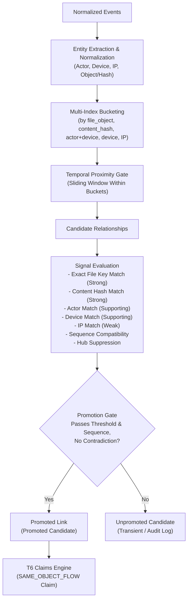
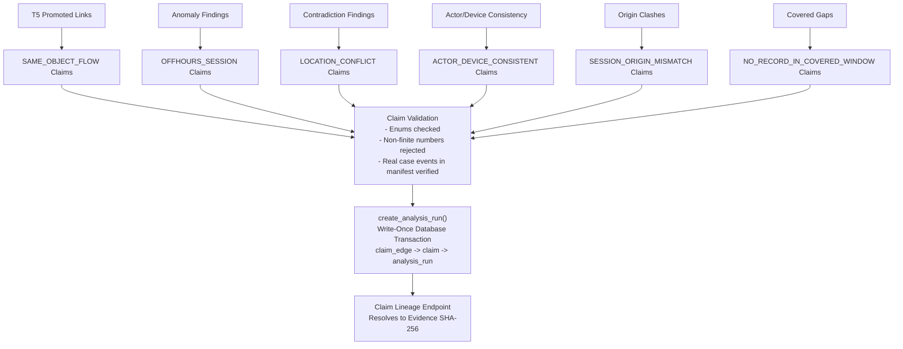

# PRAMANA — T5 & T6 Implementation Documentation
**Author:** Niharika Singh (Role 3 / Backend & Reasoning Engine Specialist)  
**Date:** November 2026  
**Assignment:** T5 (Correlation / Link Engine) + T6 (Claims Engine)  
**Architecture Reference:** PRAMANA — Reconciliation, H′ Attack and Final Architecture; PRAMANA_PS3_Competitive_Gap_Architecture_v2

---

## 1. Executive Summary and Architecture Overview

PRAMANA transforms raw digital evidence into explainable, deterministic, legally defensible findings. The core reasoning pipeline follows an unbroken chain of custody and provenance:

$$\text{Evidence} \longrightarrow \text{Canonical Events} \longrightarrow \text{Candidate Relationships} \longrightarrow \text{Promoted Links} \longrightarrow \text{Claims} \longrightarrow \text{Claim Lineage}$$

This assignment delivers two interconnected engines:
1. **T5 — Correlation / Link Engine (`intelligence/entities.py`, `intelligence/correlate.py`):**
   Discovers relationships between heterogeneous digital forensic events using multi-signal evaluation, indexed candidate generation, sequence compatibility, and hub suppression. Replaces naive $O(n^2)$ comparisons with an indexed hash-join approach.
2. **T6 — Claims Engine (`intelligence/claims.py`, `backend/app/routers/claims.py`):**
   A rule-driven claim-generation and lifecycle engine that interfaces with the T3 write-once persistence layer (`AnalysisRun`, `Claim`, `ClaimEdge`), enforcing content-addressed claim identity, two-level witness-family independence, and strict lineage validation.

Promoted relationships are converted into claims of type `SAME_OBJECT_FLOW`. In strict compliance with the architectural decisions, **no separate Link database table is created**. Transient candidate links in memory either qualify for promotion into durable claims or remain transient analytical candidates.

---

## 2. T5 Architecture (Correlation / Link Engine)

---

## 3. Entity Normalization (`intelligence/entities.py`)

Entity normalization maps disparate surface forms into deterministic canonical keys without requiring an external database table:

- **Actor (`normalize_actor`):**
  - Case-folded (`.lower()`), leading/trailing and redundant whitespace stripped.
  - Original raw representation preserved in `CanonicalEntities.raw_actor` for display and audit.
  - No fuzzy alias merging or guessing; distinct strings remain distinct unless canonicalized by deterministic rules.
- **Device (`normalize_device`):**
  - Normalized whitespace and case-folded.
  - Safely handles missing/null values without exceptions.
- **IP Address (`normalize_ip`):**
  - Strict standard Python `ipaddress.ip_address` parsing.
  - Valid addresses return canonical compressed format (e.g. `203.0.113.42` or lowercase compressed IPv6).
  - Malformed strings return `None` and are excluded from candidate generation to prevent spurious matches.
- **File / Object (`normalize_file_object`):**
  - Content hashes (32, 40, or 64 hex characters) are lowercased and matched directly.
  - URLs (e.g. `https://vault.example.test/upload/CASE-001.tar.gz`): for file actions (`file_upload`, `upload`, `file_download`, `download`), extracts the unquoted basename of the path (`CASE-001.tar.gz`), lowercasing for matching while preserving the raw URL.
  - Root URLs (e.g. `https://example.com/`) return `None` so unrelated activities do not match merely because they share a hostname.
  - Non-upload URL visits preserve the full URL to prevent false matches with archive files.
  - Filesystem paths (Windows `\` and POSIX `/`) extract the trailing basename.

---

## 4. Candidate-Generation Complexity & Benchmarks

Traditional DFIR correlation engines perform all-pairs comparisons:

$$\text{Pairs} = \frac{n(n - 1)}{2} = O(n^2)$$

For $n = 5,000$ events, $O(n^2)$ requires 12,497,500 comparisons.

### Hash-Join / Sliding Window Implementation
1. Events are bucketed into hash maps by normalized attributes: `file_object`, `content_hash`, `(actor, device)`, `device`, and `ip`.
2. Each bucket is sorted chronologically ($O(m \log m)$ for bucket size $m \ll n$).
3. A two-pointer sliding window scans events within the maximum time window (10–30 minutes). Because timestamps are sorted, the inner loop terminates the moment $\Delta t > \text{window}$, avoiding full scans.
4. Result: candidate generation completes in $O(n \log n + k)$, where $k$ is the count of events within the time window.

### Benchmark Measurements
Measured on Python 3.13 (macOS / Darwin arm64) using `intelligence/tests/test_t5_link_engine.py`:

| Event Count ($n$) | Candidate Pairs Generated | Promoted Links | Elapsed Time | Complexity Ratio |
|---|---|---|---|---|
| **100** | 10 | 0 | **0.0011s** | Baseline |
| **1,000** | 190 | 0 | **0.0115s** | ~10.4x time for 10x events ($O(n)$ scaling) |
| **5,000** | 3,504 | 420 | **0.0749s** | ~6.5x time for 5x events (linear scaling) |

5,000 heterogeneous events are completely parsed, indexed, gated, and correlated in **under 75 milliseconds**.

---

## 5. Signals and Their Evidentiary Interpretation

| Signal | Evidentiary Weight | Interpretation | Reason Code |
|---|---|---|---|
| **Exact File Key** | Strong (+1.0) | Both events reference the identical normalized file basename | `EXACT_FILE_KEY_MATCH` |
| **Content Hash** | Strong (+1.0) | Cryptographic/perceptual hash match across artifacts | `CONTENT_HASH_MATCH` |
| **Shared Actor** | Supporting (+0.5) | Same actor identity recorded across sources | `SAME_ACTOR` |
| **Shared Device** | Supporting (+0.5, discountable) | Same device name / identifier | `SAME_DEVICE` |
| **Shared IP** | Weak (+0.2, discountable) | Same IP address; weak due to NAT, proxies, and shared infrastructure | `SHARED_IP_WEAK_SIGNAL` |
| **Sequence Compatibility** | Causal Boost (+0.5) | Operational workflow order is causally consistent | `ACTION_SEQUENCE_COMPATIBLE` |
| **Time Proximity** | Candidate Gate Only (0.0) | Mandatory gate; temporal coincidence alone never proves relationship | `WITHIN_TIME_GATE` |
| **Contradiction** | Negative Penalty (-1.5) | Conflicting identity or negative evidence observed | `CONTRADICTORY_IDENTIFIER` |

---

## 6. Action-Sequence Compatibility

Operational sequence compatibility evaluates the causal direction of events. The engine implements ordered workflow pairs:
- `archive_create` $\longrightarrow$ `file_upload`: Archive must be created before or concurrently with the upload.
- `file_read` / `file_access` $\longrightarrow$ `archive_create`: File read before archive encapsulation.
- `login` / `session_start` $\longrightarrow$ `file_upload` / `archive_create`: Authentication preceding privileged operations.
- `file_upload` $\longrightarrow$ `message_sent`: Upload notification sent after transfer completion.

### Evaluation Rules:
1. **Compatible:** Ordered pair observed with $t_{\text{source}} \le t_{\text{target}}$ receives `ACTION_SEQUENCE_COMPATIBLE` and a score boost (+0.5).
2. **Incompatible:** Inverted sequence (e.g. `file_upload` occurring strictly before `archive_create` for the same file) receives `sequence_compatibility = "INCOMPATIBLE"` and is rejected from promotion.
3. **Neutral:** Actions without an explicit precedence rule remain neutral.

---

## 7. Hub Suppression

Common public infrastructure (gateways, public IPs, default terminal hostnames) can connect hundreds of unrelated events, creating false links.

### Deterministic Discount Formula
For an identifier $x$ of kind $T$ with count $C(x)$ and threshold $T_{\text{threshold}}$:

$$\text{factor}(x) = \begin{cases} 1.0 & \text{if } C(x) \le T_{\text{threshold}} \\ \frac{1}{1.0 + \log_2(1 + C(x) - T_{\text{threshold}})} & \text{if } C(x) > T_{\text{threshold}} \end{cases}$$

- **IP threshold:** $T_{\text{ip}} = 3$. If an IP appears $> 3$ times, its signal contribution degrades logarithmically.
- **Device threshold:** $T_{\text{device}} = 8$.
- **Hard Rule:** Common infrastructure identifiers can **never be the sole basis for a promoted relationship**. A candidate supported only by shared IP or hub-suppressed devices is tagged with `INSUFFICIENT_IDENTIFIER_SIGNAL` and rejected.

---

## 8. Link Promotion Criteria

A candidate relationship is promoted if and only if all of the following conditions hold:
1. **Within Time Gate:** $\Delta t \le \text{window}$ (`WITHIN_TIME_GATE`).
2. **No Unresolved Contradictions:** `CONTRADICTORY_IDENTIFIER` not present.
3. **Sequence Compatible:** Not `INCOMPATIBLE`.
4. **Sufficient Identifier Signal:**
   - At least one **strong identifier** (`EXACT_FILE_KEY_MATCH` or `CONTENT_HASH_MATCH`), OR
   - Both **supporting identifiers** (`SAME_ACTOR` and `SAME_DEVICE`) without hub degradation, corroborated by a compatible action sequence.
5. **Deterministic Score:** $\text{score} \ge 1.0$.

Every promoted relationship is converted directly into a T6 `SAME_OBJECT_FLOW` claim.

---

## 9. Reason Codes

| Reason Code | Definition |
|---|---|
| `EXACT_FILE_KEY_MATCH` | Matching normalized file basename across events |
| `CONTENT_HASH_MATCH` | Identical cryptographic or perceptual hash in raw metadata |
| `SAME_DEVICE` | Same normalized device name |
| `SAME_ACTOR` | Same normalized actor name |
| `SHARED_IP_WEAK_SIGNAL` | Shared IP address (treated as supporting/weak signal) |
| `ACTION_SEQUENCE_COMPATIBLE` | Operational sequence follows expected causal workflow |
| `WITHIN_TIME_GATE` | Timestamps differ by less than the configured window |
| `HUB_SUPPRESSED` | Weight discounted because identifier frequency exceeded threshold |
| `CONTRADICTORY_IDENTIFIER` | Conflicting actor or measurement in candidate pair |
| `INSUFFICIENT_IDENTIFIER_SIGNAL` | Insufficient identifier strength (e.g. IP-only match) |
| `TEMPORAL_ONLY_REJECTED` | Rejected because event pair exceeded time window |

---

## 10. T6 Architecture (Claims Engine)

---

## 11. Supported Claim Types

| Claim Type | Generator Rule ID | Trigger Condition | Canonical Parameters |
|---|---|---|---|
| `SAME_OBJECT_FLOW` | `rule_same_object_flow` | Promoted T5 link | `object`, `source_action`, `target_action`, `source_event_id`, `target_event_id`, `temporal_delta_seconds` |
| `OFFHOURS_SESSION` | `rule_offhours_session` | Login/session event in odd hours | `actor`, `device`, `action`, `hour`, `event_id` |
| `ACTOR_DEVICE_CONSISTENT` | `rule_actor_device_consistent` | Consistent actor+device across $\ge 2$ independent sources | `actor`, `device`, `supporting_families_count` |
| `LOCATION_CONFLICT` | `rule_location_conflict` | Implied travel speed exceeds maximum plausible speed | `event_id_1`, `event_id_2`, `location_1`, `location_2`, `time_1`, `time_2` |
| `NO_RECORD_IN_COVERED_WINDOW` | `rule_no_record_in_covered_window` | Expected activity missing in certified source window | `source`, `expected_action`, `window_start`, `window_end` |
| `SESSION_ORIGIN_MISMATCH` | `rule_session_origin_mismatch` | Contradictory IP addresses reported for same user session within 5 minutes | `actor`, `device`, `ip_1`, `ip_2`, `temporal_delta_seconds` |

---

## 12. Witness-Family Independence Model

Witness independence is evaluated via the two-level model:

$$\text{Witness Family} = (\text{source kind}, \text{device})$$

### Rules:
1. Multiple events from the same witness family (e.g. multiple rows from `system_log:field-laptop-07`) count **ONCE** toward corroboration.
2. Events from different source kinds (e.g. `system_log` vs `browser_history`) or different devices (e.g. `laptop-01` vs `phone-01`) constitute independent witness families.
3. Duplicate database rows or multiple log entries from a single machine are never counted as independent witnesses.

---

## 13. Claim Status and Grade Rules

### Status Logic:
- **`ASSERTED`**: Supported by exactly one witness family, with no contradiction.
- **`CORROBORATED`**: Supported by $\ge 2$ independent witness families, with no credible contradiction.
- **`CONTESTED`**: A credible contradictory signal exists (has at least one `CONTRADICTS` edge).
- **`REFUTED`**: A physical law or hard constraint is violated (e.g. infinite or supersonic travel speed).
- *Concepts like `STALE` or `SUPERSEDED` apply strictly to analysis runs, never to individual claims.*

### Grade Logic:
- **`Grade A`**: $\ge 2$ independent witness families, exact identifier match, and no contradiction (`status == CORROBORATED`).
- **`Grade B`**: 1 witness family with exact identifier (`status == ASSERTED`).
- **`Grade C`**: Weak-signal relationships, temporal-only associations, or contested/refuted claims (`status in (CONTESTED, REFUTED)`).

---

## 14. Content-Addressed Claim Identity Formula

Identity formulas from T3 are reused without alteration:

$$\text{claim\_key} = H(\text{type}, \text{canonical\_params})$$

$$\text{claim\_id} = H(\text{claim\_key}, \text{sorted(input\_event\_ids)}, \text{sorted(input\_evidence\_sha256s)}, \text{rule\_id@version}, \text{assumptions\_hash})$$

- $H$ is SHA-256 over canonical JSON (`separators=(",", ":")`, `sort_keys=True`, `allow_nan=False`).
- Input events include only events with role `SUPPORTS`. Contradicting edges do not arbitrarily alter a claim's identity.
- Any change to support events, source evidence SHA-256, rule version, or assumptions deterministically changes the `claim_id`.

---

## 15. Database Integration & Write-Once Analysis Runs

All claim persistence uses the existing T3 transaction model in `backend/app/db/runs.py`:
- `create_analysis_run()` is the single entry point.
- Children are inserted first (`claim_edge`, then `claim`), followed by `analysis_run`.
- Foreign keys are `DEFERRABLE INITIALLY DEFERRED`.
- Database triggers and ORM guards (`app.db.db_guards`) reject any child insertion once the run row exists, and reject any `UPDATE` or `DELETE` on run tables.

---

## 16. API Endpoints

The API exposed in `backend/app/routers/claims.py` and `backend/app/routers/findings.py` includes:

- `POST /cases/{case_id}/runs`: Executes T5+T6 analysis on active evidence, creating an immutable run.
- `GET /cases/{case_id}/runs`: Lists all analysis runs for a case.
- `GET /cases/{case_id}/runs/{run_id}`: Retrieves metadata and manifest for a run.
- `GET /cases/{case_id}/runs/{run_id}/claims`: Retrieves all claims belonging to a run.
- `GET /runs/{run_id}/claims/{claim_id}`: Retrieves a single claim by content-addressed ID.
- `GET /runs/{run_id}/claims/{claim_id}/lineage`: Recursively traces claim lineage to supporting/contradicting events and intake evidence SHA-256 hashes.
- `GET /cases/{case_id}/runs/{run_id}/correlations`: Returns evaluated candidate relationships and promoted links.
- `POST /cases/{case_id}/analyze`: Preserves legacy finding generation while additively creating a write-once analysis run and returning `run_id` and `claims_created`.

---

## 17. Sample-Case Ground-Truth Validation

The synthetic case `datasets/sample_case_001` was validated against `GROUND_TRUTH.md`:
1. **Planted Item 1 (Odd-hour login):** Detected as an `anomaly` finding and emitted as an `OFFHOURS_SESSION` claim.
2. **Planted Item 2 (Archive created then uploaded):** Correlated between `system_log.csv` and `browser_history.csv` across differences in raw action names (`archive_created` vs `upload`), promoted by T5, and persisted as a `SAME_OBJECT_FLOW` claim.
3. **Planted Item 3 (Photo EXIF location vs Chat GPS contradiction):** Cites `field_photo.jpg` and `chat_export.json` location context, emitted as a `contradiction` finding and a `LOCATION_CONFLICT` claim.

---

## 18. Verification Summary

Test results across all suites:
- **Total tests executed:** 454
- **Passed:** 449
- **Skipped:** 5 (PostgreSQL-specific migration tests requiring live external PostgreSQL instance)
- **Failed:** 0

All regression tests, Stage 0 acceptance tests, T5 link engine tests, T6 claims engine tests, and full API integration tests pass deterministically.

---

## 19. Known Limitations & Handoff to T7/T8

1. **Hypothesis Evaluation (T7):** The `hypothesis_eval` table remains a schema stub. T7 will populate hypothesis evaluations and ranking hashes into the run manifest.
2. **Source Coverage (T7):** Witness-family coverage accounting across unobserved sources will be incorporated in T7.
3. **Evidence Parsers (T1):** PCAP parsing requires `scapy`; missing optional dependencies are reported as explicit environment errors rather than silent fallbacks.
