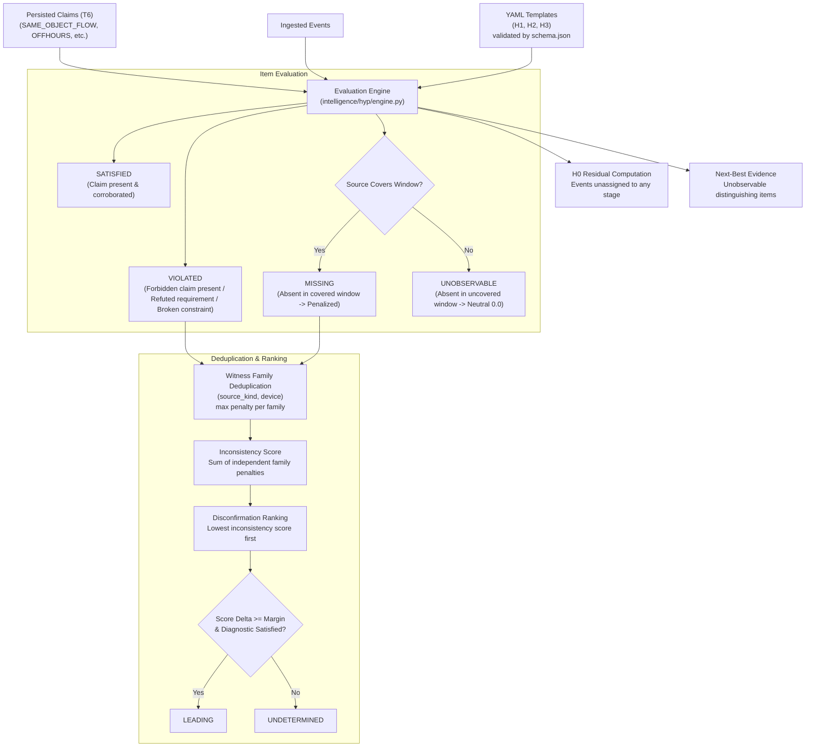
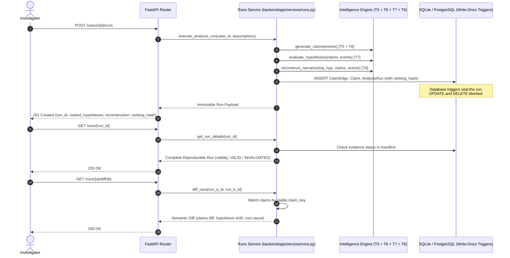

# PRAMANA — T7 & T8 Implementation Documentation
**Author:** Niharika Singh (Role 3 / Backend & Digital Forensics Specialist)  
**Date:** November 2026  
**Assignment:** T7 (Hypothesis Engine) + T8 (Reconstruction Engine & Immutable Analysis Runs)  
**Architecture Reference:** PRAMANA — Reconciliation, H′ Attack and Final Architecture; PRAMANA_PS3_Competitive_Gap_Architecture_v2

---

## 1. Executive Summary and Architecture Overview

PRAMANA transforms raw digital forensic evidence into explainable, deterministic, legally defensible investigative conclusions. Building on the foundation of T5 (Correlation / Link Engine) and T6 (Claims Engine), deliverables T7 and T8 complete the forensic reasoning pipeline:

$$\text{Evidence} \longrightarrow \text{Events} \longrightarrow \text{Promoted Links} \longrightarrow \text{Claims} \longrightarrow \text{Competing Hypotheses} \longrightarrow \text{Reconstruction}$$

### Core Deliverables
1. **T7 — Hypothesis Engine (`intelligence/hyp/engine.py`, `intelligence/templates/`):**
   - YAML-based hypothesis templates validated against strict JSON Schema (`schema.json`).
   - Three competing hypotheses (H1: Insider Exfiltration, H2: Sanctioned Backup, H3: Session Misuse) and H0 (Computed Residual).
   - Disconfirmation-based ranking: hypotheses are ranked by *inconsistency/disconfirmation*, NOT confirmation.
   - Two-level witness family deduplication: `(source_kind, device)` taking the maximum contribution.
   - Coverage-aware evaluation: `MISSING` (covered window) penalizes, but `UNOBSERVABLE` (uncovered source window) is strictly neutral.
   - Non-diagnostic evidence filtering (evidence consistent across all competing hypotheses).
   - Next-best evidence recommendations prioritizing unobservable distinguishing items.
2. **T8 — Reconstruction & Immutable Analysis Runs (`intelligence/hyp/reconstruct.py`, `backend/app/services/runs.py`):**
   - Computed chronological narrative reconstruction over immutable runs.
   - Stage status (`SUPPORTED` vs `GAP`) and rigorous `TimeInterval` interval arithmetic (`PRECEDES`, `CONCURRENT_OR_OVERLAPPING`, `OUT_OF_ORDER`, `GAP_DETECTED`).
   - Write-once immutable analysis runs (`POST /cases/{id}/runs`, `GET /runs/{id}`) committed with cryptographic `ranking_hash`.
   - Invalidation tracking when evidence is quarantined or removed.
   - Semantic run diffing (`GET /runs/{a}/diff/{b}`) matching claims by stable `claim_key` and explaining root cause of conclusion changes.

---

## 2. T7 Architecture: Hypothesis Engine



### 2.1 YAML Hypothesis Templates (`intelligence/templates/`)

All templates are validated against `intelligence/templates/schema.json` using JSON Schema Draft 2020-12.

Each template declares:
- `id`: Unique identifier (`H1`, `H2`, `H3`).
- `kind`: Semantic classification (`insider_exfiltration`, `sanctioned_backup`, `session_misuse`).
- `stages`: Ordered list of lifecycle stages.
- `requires`: Mandatory evidence items for hypothesis viability.
- `expects`: Corroborating items expected under normal operation of the hypothesis.
- `forbids`: Contradicting items that falsify the hypothesis.
- `constraints`: Minimal constraint language supporting only:
  - `same(actor|device)`
  - `before(stageA, stageB)`
  - `within(minutes)`

#### The Three Competing Hypotheses:
1. **H1: Insider Exfiltration (`exfil_insider.yaml`):**
   - Account holder intentionally accesses, stages, archives and uploads sensitive information.
   - Requires: `ACTOR_DEVICE_CONSISTENT` (access stage) and `SAME_OBJECT_FLOW` (exfiltration stage).
   - Expects: `OFFHOURS_SESSION` (staging stage) and `NO_RECORD_IN_COVERED_WINDOW` (evasion stage).
   - Forbids: `SESSION_ORIGIN_MISMATCH` (remote hijack conflict) and `LOCATION_CONFLICT`.
   - Constraints: `same(actor)`, `same(device)`, `before(access, exfiltration)`, `within(1440m)`.
2. **H2: Sanctioned Backup (`sanctioned_backup.yaml`):**
   - The activity is part of an authorized or scheduled backup process.
   - Requires: `ACTOR_DEVICE_CONSISTENT` (authorization stage) and `SAME_OBJECT_FLOW` (backup transfer stage).
   - Expects: `ACTOR_DEVICE_CONSISTENT` routine operational logging (verification stage).
   - Forbids: `OFFHOURS_SESSION` (staging outside maintenance window), `NO_RECORD_IN_COVERED_WINDOW`, and `SESSION_ORIGIN_MISMATCH`.
   - Constraints: `same(device)`, `before(authorization, backup_transfer)`, `within(720m)`.
3. **H3: Session Misuse (`session_misuse.yaml`):**
   - Another person uses an existing account or session to perform unauthorized operations.
   - Requires: `SESSION_ORIGIN_MISMATCH` (initial access stage).
   - Expects: `OFFHOURS_SESSION` (unauthorized activity stage) and `SAME_OBJECT_FLOW` (egress stage).
   - Forbids: Clean audit records disproving remote origin conflicts.
   - Constraints: `same(actor)`, `within(1440m)`.

### 2.2 Coverage-Aware Evaluation: MISSING vs UNOBSERVABLE

In forensic analysis, an investigator must distinguish between a genuine anomaly (evidence that should have been present in an active log, but wasn't) and a data collection limitation (the log source was never collected):

- **`MISSING`:** The source was actively recording events during the relevant time window (e.g. system log was running), but the expected event or record did not occur. This represents evidence of absence and contributes a disconfirmation penalty.
- **`UNOBSERVABLE`:** The source was not collected, or its coverage window does not cover the relevant interval. **UNOBSERVABLE is strictly neutral ($0.0$ penalty)** and never penalizes a hypothesis.

### 2.3 Disconfirmation-Based Ranking & Witness Family Deduplication

- **Disconfirmation Principle:** Hypotheses are evaluated and ranked based on their inconsistency and contradictions. Hypotheses with lower inconsistency scores rank higher.
- **Two-Level Witness Family:** `family = (source_kind, device)`. If multiple contradictory claims arise from the same physical or logical family (e.g. multiple off-hours warnings on `system_log:srv-01`), they count **once** using the maximum penalty:
  $$\text{Score}(H) = \sum_{f \in \text{Families}} \max_{i \in f} \text{Penalty}(i)$$
- **Diagnostic Margin:** A hypothesis is awarded `status: "LEADING"` only if:
  1. It is `VIABLE` (all requirements satisfied, zero hard violations).
  2. It has at least one *diagnostic* satisfied evidence item (not common to all hypotheses).
  3. It beats the next-best hypothesis by at least the configured margin ($\Delta S \ge 0.5$) or the competing hypothesis is `REFUTED` / `WEAKENED`.
  If competing hypotheses are tied or within the margin, the case outcome is returned as `UNDETERMINED`.

### 2.4 H0 Residual Hypothesis

Events that are not referenced by or assigned to any stage across all evaluated competing hypotheses are gathered into $H_0$. $H_0$ appears in the analysis output with its unassigned event count and event IDs, but is **never scored or ranked as a competing hypothesis**.

### 2.5 Next-Best Evidence Recommendations

Calculates which additional evidence would best distinguish the top two hypotheses ($H_a$ vs $H_b$), prioritizing expected items that are currently `UNOBSERVABLE`. Returns what evidence is needed, which source should contain it, which hypotheses it distinguishes, and why collecting it matters.

---

## 3. T8 Architecture: Reconstruction & Immutable Runs



### 3.1 Narrative Reconstruction (`intelligence/hyp/reconstruct.py`)

Reconstruction is a **computed view** over immutable runs and case events. For every stage in the hypothesis:
- Status: `SUPPORTED` (backed by claims and events) vs `GAP` (unobserved stage).
- Interval Arithmetic: Uses `TimeInterval` to evaluate stage-to-stage transitions:
  - `PRECEDES`: `prev.hi < curr.lo` (strictly sequential).
  - `CONCURRENT_OR_OVERLAPPING`: `prev.overlaps(curr)`. **Overlapping intervals are never asserted as definite precedence.**
  - `OUT_OF_ORDER`: `prev.definitely_after(curr)`.
  - `GAP_DETECTED`: One or both stages is a `GAP`.
- Background Activity: Separates non-hypothesis events from attack stage events.

### 3.2 Write-Once Analysis Runs & Integrity Enforcement

- **Write-Once Ordering:** In one atomic transaction, rows are written in strict sequence:
  $$\text{claim\_edge} \longrightarrow \text{claim} \longrightarrow \text{analysis\_run (last)}$$
- **Database-Level Protection:** Database triggers (`db_guards.py`) and SQLAlchemy ORM listeners enforce:
  - `analysis_run`, `claim`, `claim_edge`: `UPDATE` and `DELETE` raise `ImmutableRecordError`.
  - Child rows cannot be inserted once their parent `analysis_run` row exists.
- **Cryptographic Ranking Hash:** Every run stores `ranking_hash = H(ranked_hypotheses)`. On retrieval via `GET /runs/{id}`, the ranking hash is recomputed and verified (`ranking_hash_verified: true`).

### 3.3 Run Invalidation Lifecycle

When an evidence item is quarantined or removed (`POST /evidence/{id}/verify` mismatch or `POST /evidence/{id}/remove`):
- Existing runs containing the evidence are **never modified or deleted** (preserving forensic history).
- On inspection via `GET /runs/{id}`, runs citing quarantined evidence are dynamically flagged:
  ```json
  {
    "is_valid": false,
    "validity": "INVALIDATED",
    "invalidation_reasons": ["Evidence 'EVID-002' status is now REMOVED (verify_state: null)"]
  }
  ```
- Re-running analysis creates an updated child run (`parent_run_id = run_a`).

### 3.4 Semantic Run Diffing (`GET /runs/{a}/diff/{b}`)

Comparing two runs by `claim_id` would fail because `claim_id` hashes the input evidence SHA-256s, causing identical semantic claims to change IDs across runs.

`diff_runs` matches claims by **`claim_key = H(type, canonical params)`**:
- `added_claims`: Claims introduced in Run B.
- `removed_claims`: Claims from Run A invalidated due to quarantined evidence.
- `modified_claims`: Claims present in both where `status` (e.g. `ASSERTED` $\to$ `REFUTED`) or `grade` changed.
- `unchanged_count`: Claims with identical status and grade.
- `hypothesis_diffs`: Rank, score, and status transitions for all hypotheses.
- `root_cause_analysis`: Automated forensic explanation identifying which quarantined evidence caused which claims to disappear and why hypothesis rankings shifted.

---

## 4. API Endpoints

| Method | Endpoint | Description |
|---|---|---|
| `POST` | `/cases/{id}/runs` | Create an immutable analysis run with T5-T8 evaluation |
| `GET` | `/cases/{id}/runs` | List all analysis runs for a case |
| `GET` | `/cases/{id}/runs/{run_id}` | Retrieve run metadata and full evaluation |
| `GET` | `/runs/{run_id}` | Retrieve complete reproducible run with manifest, claims, hypotheses, reconstruction |
| `GET` | `/runs/{run_a_id}/diff/{run_b_id}` | Compare two immutable runs matching claims by `claim_key` |
| `POST` | `/cases/{id}/analyze` | Case analysis alias creating an immutable analysis run |

---

## 5. Test Suite Verification

The complete PRAMANA test suite passes with zero errors:

```text
======================= 483 passed, 5 skipped, 62 warnings in 5.99s =======================
```

### Key Test Suites:
- `intelligence/tests/test_t7_hypothesis.py` (11 tests):
  - Golden cases for H1, H2, H3, and UNDETERMINED.
  - Disconfirmation ranking and witness family deduplication.
  - MISSING vs UNOBSERVABLE coverage handling.
  - Non-diagnostic evidence detection.
  - H0 residual computation and next-best evidence generation.
- `intelligence/tests/test_t8_reconstruct.py` (4 tests):
  - Stage progression (SUPPORTED vs GAP).
  - Interval ordering via `TimeInterval` (`PRECEDES`, `CONCURRENT_OR_OVERLAPPING`).
  - Background activity and H0 separation.
- `backend/tests/test_t8_runs_diff.py` (4 tests):
  - Database-level write-once run immutability (UPDATE/DELETE blocked).
  - Run retrieval and `ranking_hash` verification.
  - Evidence quarantine run invalidation (`is_valid=False`).
  - Semantic run diffing matching claims by `claim_key` with root-cause analysis.
